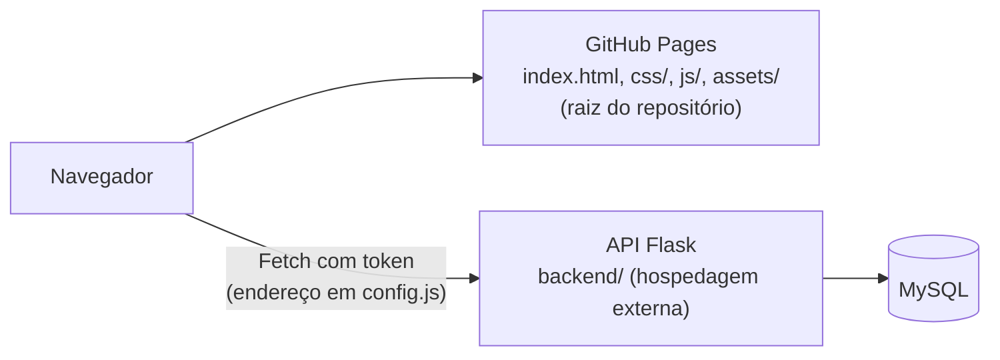

# StudyHub

Plataforma de estudos desenvolvida para o **Projeto Integrado (DWS + POO + BD)** do Colégio UNASP, 2º TIA.

Cada pessoa cria a sua conta e estuda com quatro módulos ligados por uma camada de gamificação:

- **Pomodoro**: cronômetro de foco e pausas, com registro das sessões por matéria.
- **Planner**: tópicos por matéria, com status (não visto, estudando, revisado).
- **Flashcards**: baralhos e cartões com repetição espaçada.
- **Gamificação**: XP, níveis e conquistas.

E ainda: login e cadastro, perfil com foto, tema claro e escuro salvo na conta, pesquisa, guia interativo e o **Bu**, um fantasminha em pixel art que serve de assistente.

## Tecnologias

- **Front-end:** HTML, CSS e JavaScript puro (módulos ES), na **raiz do repositório**, publicado pelo **GitHub Pages**.
- **Back-end:** Python 3 com Flask (Programação Orientada a Objetos: models, DAOs, services e rotas), hospedado à parte.
- **Banco de dados:** MySQL (13 tabelas). Há também um modo SQLite para testar sem instalar nada.

## Arquitetura



O GitHub Pages só entrega arquivos estáticos: ele não executa Python. Por isso o back-end roda em outro lugar (no seu computador ou numa hospedagem) e o site conversa com ele pela API.

## Estrutura do repositório

```
studyhub/
├── index.html            ← entrada do site (fica na raiz, para o GitHub Pages)
├── 404.html              ← leva endereços como /studyhub/planner para /studyhub/#/planner
├── config.js             ← endereço da API (API_URL)
├── .nojekyll
├── css/style.css         ← temas claro e escuro, animações e responsividade
├── js/
│   ├── main.js           ← rotas (#/...), estrutura e sessão
│   ├── api.js            ← todas as chamadas Fetch à API
│   ├── ghost.js          ← o fantasminha Bu
│   ├── tour.js           ← guia interativo
│   ├── search.js         ← pesquisa
│   ├── theme.js, timer.js, state.js, ui.js, util.js
│   └── pages/            ← uma página por arquivo (login, dashboard, pomodoro...)
├── assets/favicon.svg
├── backend/              ← API Flask (NÃO vai para o GitHub Pages)
│   ├── app.py, wsgi.py, config.py, db.py, init_db.py
│   ├── auth.py           ← exige login e confere o dono de cada registro
│   ├── models/, dao/, services/, routes/
│   └── .env.example
├── database/             ← schema.sql e seed.sql (MySQL) e sqlite/
├── docs/                 ← API.md, diagrama de classes, entrega/studyhub.sql
├── tests/                ← testes automatizados do back-end
└── .github/
    ├── montar-site.sh    ← separa só os arquivos públicos do site
    └── workflows/        ← publicação no Pages e testes com MySQL
```

## Rodar no seu computador

### O que instalar antes

1. **Python 3.9 ou superior** (https://www.python.org). No Windows, marque "Add Python to PATH" na instalação.
2. **MySQL** ligado. Pode ser o **XAMPP** (botão *Start* no MySQL) ou o **MySQL Server**.

### Passo a passo

```bash
# 1. Instalar as bibliotecas (na pasta do projeto)
pip install -r requirements.txt

# 2. Configurar o acesso ao MySQL
#    copie backend/.env.example para backend/.env e ajuste usuário e senha
#    (no XAMPP o usuário é "root" e a senha fica em branco)

# 3. Criar o banco, as tabelas e as conquistas
python backend/init_db.py

# 4. Ligar o sistema
python backend/app.py
```

Abra **http://127.0.0.1:5000**, clique em **Criar conta** e pronto. Nesse modo, o próprio Flask entrega o site e a API no mesmo endereço, e o `config.js` fica com `API_URL: ""`.

- Para apagar tudo e recriar o banco: `python backend/init_db.py --reset`
- Para testar a recuperação de senha sem servidor de e-mail, coloque `STUDYHUB_DEV_RESET=1` no `backend/.env`: o link aparece na própria tela. **Use isso só no seu computador.**
- Sem MySQL à mão? Coloque `STUDYHUB_BANCO=sqlite` no `backend/.env` e rode os passos 3 e 4. Para a entrega, use o MySQL.

### Se der erro

| Mensagem | O que fazer |
|---|---|
| `O PyMySQL não está instalado` | rode `pip install -r requirements.txt` |
| `Usuário ou senha do MySQL incorretos` | corrija `STUDYHUB_DB_USER` e `STUDYHUB_DB_PASSWORD` no `backend/.env` |
| `Não consegui conectar ao MySQL` | ligue o MySQL (XAMPP: *Start*) e confira host e porta no `.env` |
| Tela "Não deu para falar com o servidor" | o `python backend/app.py` precisa estar rodando |

## Publicar o site no GitHub Pages

O site já está pronto para o endereço `https://SEU-USUARIO.github.io/NOME-DO-REPOSITORIO/`: todos os caminhos são relativos e as telas usam rotas com `#` (por exemplo `#/planner`), então atualizar a página ou abrir um link direto nunca dá 404.

1. Envie o projeto para o GitHub (a branch pode se chamar `main` ou `master`).
2. No repositório, abra **Settings > Pages**.
3. Em **Build and deployment > Source**, escolha **GitHub Actions**.
4. Abra a aba **Actions**: o fluxo **Publicar no GitHub Pages** roda sozinho a cada envio (ou clique em *Run workflow*).
5. Quando terminar, o endereço do site aparece em **Settings > Pages** e no resumo do fluxo.

O fluxo (`.github/workflows/pages.yml`) usa o script `.github/montar-site.sh`, que copia **só** `index.html`, `404.html`, `config.js`, `css/`, `js/` e `assets/` para o pacote publicado. Os arquivos continuam na raiz do repositório; `backend/`, `database/`, `docs/` e `tests/` nunca ficam públicos no site.

### Ligar o site publicado à API

O site no GitHub Pages precisa saber onde está o back-end. Escolha uma opção:

- **Recomendado:** em **Settings > Secrets and variables > Actions > Variables**, crie a variável `STUDYHUB_API_URL` com o endereço da API (exemplo: `https://seu-usuario.pythonanywhere.com`) e rode o fluxo de novo. O `config.js` publicado é gerado com esse endereço.
- **Ou** edite `API_URL` no `config.js` e envie.

Sem esse endereço, a tela de login mostra o aviso **"Falta ligar o back-end"** em vez de quebrar.

## Hospedar o back-end

Qualquer hospedagem que rode Python (WSGI) serve. O ponto de entrada é `backend/wsgi.py`. Exemplo com gunicorn:

```bash
gunicorn --chdir backend wsgi:application
```

Configure estas variáveis de ambiente (ou um `backend/.env` no servidor):

| Variável | Para quê | Exemplo |
|---|---|---|
| `STUDYHUB_DB_HOST`, `_PORT`, `_USER`, `_PASSWORD`, `_NAME` | acesso ao MySQL | |
| `STUDYHUB_CORS_ORIGINS` | o endereço do site que pode chamar a API (sem a pasta do repositório) | `https://seu-usuario.github.io` |
| `STUDYHUB_APP_URL` | endereço completo do site, usado no e-mail de recuperação | `https://seu-usuario.github.io/studyhub` |
| `STUDYHUB_SMTP_HOST`, `_PORT`, `_USER`, `_PASSWORD`, `_FROM` | envio do e-mail de recuperação de senha | |
| `STUDYHUB_TRUST_PROXY` | `1` se a hospedagem fica atrás de um proxy (para o limite de tentativas ver o IP certo) | `1` |

Depois de configurar, rode `python backend/init_db.py` uma vez no servidor para criar as tabelas.

**Atenção:** a API precisa estar em **HTTPS**, porque o GitHub Pages é HTTPS e o navegador bloqueia chamadas de uma página segura para um endereço `http://`. Nunca use `python backend/app.py` como servidor de produção: ele liga o modo de depuração do Flask.

**Sobre o PythonAnywhere:** ele roda Flask, mas desde janeiro de 2026 as contas gratuitas novas não incluem MySQL, e o app gratuito expira se não for renovado a cada mês ([anúncio](https://blog.pythonanywhere.com/221/), [recursos da conta gratuita](https://help.pythonanywhere.com/pages/FreeAccountsFeatures/)). Numa conta gratuita nova dá para publicar uma demonstração com `STUDYHUB_BANCO=sqlite`; para usar MySQL lá, é preciso um plano pago ou outro serviço de banco.

## Segurança

- **Senhas:** guardadas só como hash (PBKDF2-SHA256 com sal). A mensagem de login errado é a mesma para e-mail inexistente e senha errada.
- **Sessões:** token aleatório; o banco guarda só o hash dele. O login dura 12 horas, ou 30 dias com "lembrar de mim". "Sair" invalida o token no servidor. Sem "lembrar de mim", o login some ao fechar o navegador, o que protege computadores compartilhados (abas abertas do site passam o login para uma aba nova).
- **Autorização no servidor:** `backend/auth.py` roda antes de qualquer rota e recusa quem não está logado (401), quem tenta abrir dados de outro usuário (403) e registros de outra pessoa (404). Esconder telas no JavaScript não é tratado como proteção.
- **Perfil:** trocar o e-mail ou a senha exige a senha atual e desconecta os outros aparelhos. A foto tem o tipo conferido pelos bytes do arquivo (JPG, PNG ou WebP), com limite de tamanho.
- **Recuperação de senha:** link de uso único, válido por 30 minutos, que não revela se o e-mail existe.
- **Outros:** limite de tentativas no login, no cadastro e na recuperação; CORS liberado só para os endereços configurados; SQL sempre parametrizado; todo texto exibido no site passa por escape (contra XSS).

## Testes

```bash
python -m unittest discover -s tests -v
```

São 64 testes: regras do domínio, API, login, autorização entre usuários, foto, recuperação de senha, pesquisa e CORS. Com o MySQL ligado, eles criam e apagam um banco separado, `studyhub_teste`, e o banco `studyhub` nunca é tocado. Para rodar sem MySQL: `STUDYHUB_BANCO=sqlite python -m unittest discover -s tests`.

O fluxo `.github/workflows/testes.yml` roda os mesmos testes num **MySQL 8 de verdade** e no SQLite a cada envio para o GitHub (aba **Actions**).

## Documentação

- [`docs/API.md`](docs/API.md): todas as rotas, autenticação, regras de XP e conquistas.
- [`docs/diagrama_classes.md`](docs/diagrama_classes.md): diagrama de classes (UML).
- [`docs/entrega/studyhub.sql`](docs/entrega/studyhub.sql): script básico de criação do banco para o professor.

## Etapas de entrega

| Etapa | Prazo | Conteúdo | Situação |
|---|---|---|---|
| Etapa 1 | 09/11/2026 | UML revisado, tabelas criadas e funcionando, conexão inicial com o banco | Concluída |
| Etapa 2 | 13/11/2026 | Back-end em Python: classes, DAOs e rotas Flask (POO), cadastro e consulta no banco | Concluída |
| Entrega Final | 17/11/2026 | Sistema completo, com front-end (HTML/CSS/JS) consumindo as rotas Flask via Fetch | Concluída |

## Autor

Andriely Gamba - 2°TIA
