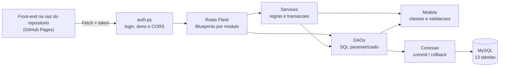

# API do StudyHub

Base: `http://127.0.0.1:5000/api` no computador, ou o endereço onde o back-end estiver hospedado.
Todas as rotas recebem e devolvem JSON.

## Autenticação

1. `POST /auth/cadastro` ou `POST /auth/login` devolvem um **token**.
2. Todas as outras rotas exigem o cabeçalho `Authorization: Bearer <token>`. Sem ele, ou com token vencido, a resposta é **401**.
3. A autorização é feita no servidor (`backend/auth.py`), antes de qualquer rota rodar:
   - em `/usuarios/<id>/...`, o `<id>` precisa ser o do próprio usuário logado (senão **403**);
   - em `/materias/<id>`, `/topicos/<id>`, `/sessoes/<id>`, `/baralhos/<id>` e `/cartoes/<id>`, o registro precisa ser do usuário logado (senão **404**, sem revelar que ele existe).
4. A senha é guardada só como hash (PBKDF2-SHA256 com sal). Do token, o banco guarda só o hash SHA-256.
5. O login dura 12 horas, ou 30 dias com "lembrar de mim". `POST /auth/logout` invalida o token no servidor.

Rotas públicas (sem login): `GET /health`, `POST /auth/cadastro`, `POST /auth/login`, `POST /auth/esqueci-senha` e `POST /auth/redefinir-senha`.

## Arquitetura do back-end



- **auth.py**: exige o login, confere o dono de cada registro e libera o CORS só para os endereços configurados.
- **Rotas** (`backend/routes`): recebem a requisição, validam o corpo e devolvem JSON.
- **Services** (`backend/services`): regras que envolvem mais de uma tabela. Cada ação (por exemplo, registrar a sessão e dar XP) é **uma transação só**: se algo falhar, nada é gravado. O `AuthService` cuida de senhas, tokens, perfil e recuperação de senha.
- **DAOs** (`backend/dao`): todo o SQL do projeto, sempre parametrizado.
- **Models** (`backend/models`): classes com atributos privados, validações e regras (nível, repetição espaçada, status do tópico).

## Códigos de resposta

| Código | Quando |
|---|---|
| 200 / 201 / 204 | sucesso / criado / apagado |
| 400 | dado inválido (`{"erro": "mensagem"}`) |
| 401 | sem login, token vencido ou senha incorreta |
| 403 | tentativa de acessar os dados de outro usuário |
| 404 | registro não encontrado (ou de outro usuário) |
| 409 | conflito: e-mail ou nome repetido, matéria em uso |
| 413 | corpo da requisição maior que 2 MB |
| 429 | muitas tentativas de login, cadastro ou recuperação em pouco tempo |

## Regras de gamificação

| Ação | XP |
|---|---|
| Sessão Pomodoro concluída | `duracao_min × 2 ÷ 5` (25 min = 10 XP). Sessão interrompida não dá XP |
| Tópico marcado como `revisado` (só na primeira vez) | 15 |
| Cartão acertado | 3 |
| Cartão errado | 1 |

Nível = `1 + xp_total ÷ 100`. Conquistas (o bônus de XP é pago automaticamente):

| Código | Regra | Bônus |
|---|---|---|
| `primeira_sessao` | 1 sessão concluída | 20 |
| `dez_sessoes` | 10 sessões concluídas | 50 |
| `primeiro_topico` | 1 tópico revisado | 20 |
| `cinco_topicos` | 5 tópicos revisados | 50 |
| `primeiro_cartao` | 1 cartão revisado | 10 |
| `cinquenta_cartoes` | 50 cartões revisados | 60 |
| `nivel_5` | chegar ao nível 5 | 100 |

**Repetição espaçada:** ao acertar, o intervalo até a próxima revisão dobra (1, 2, 4, 8... até 365 dias); ao errar, volta para 1 dia.

As rotas que geram XP devolvem o campo `gamificacao`, pronto para o front-end mostrar avisos:

```json
{
  "origem": "pomodoro", "pontos": 10, "xp_bonus_conquistas": 20,
  "xp_total": 30, "nivel": 1, "subiu_de_nivel": false,
  "conquistas_desbloqueadas": [{"codigo": "primeira_sessao", "nome": "Primeiro Foco", "xp_bonus": 20}]
}
```

## Rotas

### Autenticação
| Método | Rota | Corpo | Observação |
|---|---|---|---|
| POST | `/auth/cadastro` | `{nome, email, senha, confirmar_senha, tema?}` | nome completo; senha com 8+ caracteres, letras e números; 409 se o e-mail existe. Cria as 9 matérias padrão e devolve `{token, usuario}` |
| POST | `/auth/login` | `{email, senha, lembrar?}` | 401 com a mesma mensagem para e-mail inexistente ou senha errada; 429 depois de 8 erros em 10 min |
| POST | `/auth/logout` | | invalida o token |
| GET | `/auth/eu` | | o usuário logado, com a `foto` |
| POST | `/auth/esqueci-senha` | `{email}` | sempre a mesma resposta (não revela se a conta existe). Envia o link por e-mail se o SMTP estiver configurado |
| POST | `/auth/redefinir-senha` | `{token, senha, confirmar_senha}` | link de uso único, válido por 30 min; encerra todas as sessões |

### Perfil e pesquisa
| Método | Rota | Corpo | Observação |
|---|---|---|---|
| PUT | `/perfil` | `{nome?, apelido?, bio?, tema?, tutorial_visto?}` | outros campos são ignorados (não dá para mudar XP ou e-mail por aqui) |
| POST | `/perfil/email` | `{novo_email, senha}` | exige a senha; desconecta os outros aparelhos |
| POST | `/perfil/senha` | `{senha_atual, nova_senha, confirmar_senha}` | desconecta os outros aparelhos |
| PUT | `/perfil/foto` | `{imagem: "data:image/...;base64,..."}` | JPG, PNG ou WebP, até 300 KB; o tipo é conferido pelo conteúdo do arquivo |
| DELETE | `/perfil/foto` | | volta para o avatar padrão |
| POST | `/perfil/excluir` | `{senha}` | apaga a conta e tudo que é dela |
| GET | `/busca?q=termo` | | tópicos, baralhos, cartões, matérias e conquistas que contêm o termo (2+ letras), só do usuário logado |

### Usuário
| Método | Rota | Observação |
|---|---|---|
| GET | `/usuarios/<id>` | só o próprio usuário |
| GET | `/usuarios/<id>/dashboard` | dados da tela inicial (veja abaixo) |

### Matérias (cada usuário tem as suas)
| Método | Rota | Corpo | Observação |
|---|---|---|---|
| GET | `/materias` | | as matérias do usuário logado, em ordem alfabética |
| POST | `/materias` | `{nome, cor?}` | `cor` no formato `#RRGGBB`; 409 se você já tem uma com esse nome |
| GET / PUT / DELETE | `/materias/<id>` | `{nome?, cor?}` | DELETE dá 409 se a matéria estiver em uso |

### Planner (tópicos)
| Método | Rota | Corpo | Observação |
|---|---|---|---|
| GET | `/usuarios/<id>/topicos` | | filtros: `?materia_id=` e `?status=` |
| POST | `/usuarios/<id>/topicos` | `{materia_id, titulo}` | nasce como `nao_visto` |
| GET / PUT / DELETE | `/topicos/<id>` | `{titulo?, materia_id?}` | |
| PATCH | `/topicos/<id>/status` | `{status}` | só avança; ao virar `revisado` gera XP |
| POST | `/topicos/<id>/avancar` | | vai para o próximo status |

Resposta de status e avançar: `{"topico": {...}, "gamificacao": {...} ou null}`.

### Pomodoro (sessões)
| Método | Rota | Corpo | Observação |
|---|---|---|---|
| GET | `/usuarios/<id>/sessoes` | | filtros: `?de=AAAA-MM-DD&ate=AAAA-MM-DD` |
| POST | `/usuarios/<id>/sessoes` | `{materia_id, duracao_min, topico_id?, concluida?}` | duração de 1 a 240 min; `concluida` é `true` por padrão; se vier `topico_id` sem `materia_id`, usa a matéria do tópico |
| GET / DELETE | `/sessoes/<id>` | | apagar a sessão não retira o XP já ganho |

Resposta do POST: `{"sessao": {...}, "gamificacao": {...} ou null}`.

### Flashcards
| Método | Rota | Corpo | Observação |
|---|---|---|---|
| GET | `/usuarios/<id>/baralhos` | | traz `materia`, `total_cartoes` e `para_revisar` |
| POST | `/usuarios/<id>/baralhos` | `{materia_id, nome}` | |
| GET / PUT / DELETE | `/baralhos/<id>` | `{nome?, materia_id?}` | o GET traz os `cartoes` |
| GET | `/baralhos/<id>/cartoes` | | |
| POST | `/baralhos/<id>/cartoes` | `{frente, verso}` | já fica disponível para revisar hoje |
| GET | `/baralhos/<id>/revisar` | | cartões que vencem hoje ou antes |
| GET | `/usuarios/<id>/cartoes/pendentes` | | pendentes de todos os baralhos |
| PUT / DELETE | `/cartoes/<id>` | `{frente?, verso?}` | |
| POST | `/cartoes/<id>/revisao` | `{acertou: true/false}` | reagenda o cartão e gera XP |

Resposta da revisão: `{"cartao": {...}, "revisao": {...}, "gamificacao": {...}}`.

### Gamificação
| Método | Rota | Observação |
|---|---|---|
| GET | `/conquistas` | catálogo com todas as conquistas |
| GET | `/usuarios/<id>/conquistas` | as que o usuário já desbloqueou |
| GET | `/usuarios/<id>/xp` | extrato de XP (`?limite=`, padrão 20) |

### Dashboard
`GET /usuarios/<id>/dashboard` devolve, em uma chamada: `usuario` (com nível), `pomodoro` (minutos na semana, minutos por dia dos últimos 7 dias, minutos por matéria), `planner` (progresso por matéria), `flashcards` (cartões para revisar hoje e resumo dos baralhos) e `gamificacao` (conquistas e últimos XP).

## Como testar

```bash
python -m unittest discover -s tests -v
```

Com o MySQL ligado, os testes criam (e apagam) um banco separado chamado `studyhub_teste`. O banco `studyhub`, com os seus dados, nunca é tocado.
