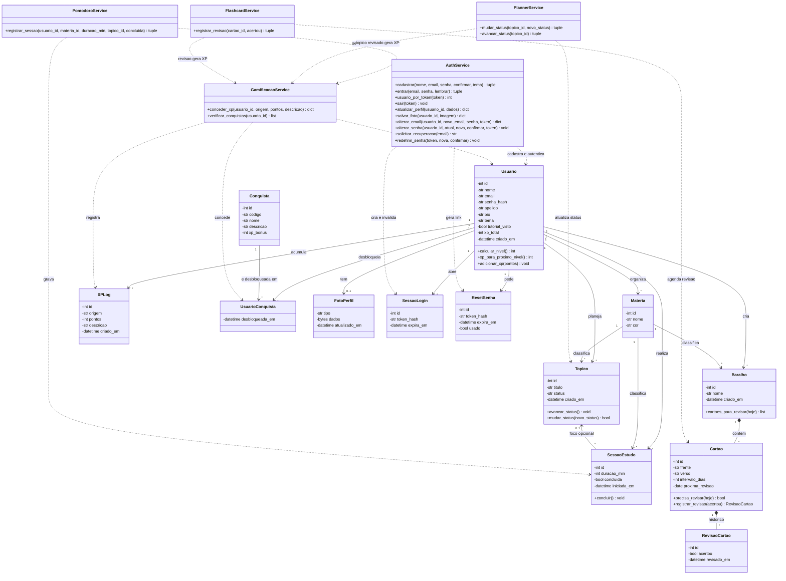

# Diagrama de Classes (UML) - StudyHub

Diagrama de classes do domínio e dos services. O GitHub renderiza o bloco abaixo automaticamente.
O mesmo diagrama está em `diagrama_classes.mermaid`.

## Correspondência entre classes e tabelas do banco

| Classe | Tabela | Observação |
|---|---|---|
| Usuario | `usuario` | senha guardada só como hash; `xp_total` é atualizado pelo GamificacaoService |
| Materia | `materia` | cada usuário tem as suas matérias |
| Topico | `topico` | status: `nao_visto`, `estudando`, `revisado` (só avança) |
| SessaoEstudo | `sessao_estudo` | `topico_id` é opcional |
| Baralho | `baralho` | pertence a um usuário e a uma matéria |
| Cartao | `cartao` | `intervalo_dias` e `proxima_revisao` controlam a repetição espaçada |
| RevisaoCartao | `revisao_cartao` | histórico de acertos e erros |
| XPLog | `xp_log` | origem: `pomodoro`, `topico`, `flashcard`, `conquista` |
| Conquista | `conquista` | `codigo` identifica a regra no GamificacaoService |
| UsuarioConquista | `usuario_conquista` | tabela associativa N:N entre Usuario e Conquista |
| FotoPerfil | `foto_perfil` | foto de perfil (imagem guardada no banco) |
| SessaoLogin | `sessao_login` | sessões de login; só o hash do token |
| ResetSenha | `reset_senha` | links de recuperação de senha, de uso único |
| AuthService | (sem tabela) | cadastro, login, perfil, troca de senha e recuperação |
| GamificacaoService | (sem tabela) | concede XP e confere conquistas; usado pelos 3 services de módulo |
| PomodoroService, PlannerService, FlashcardService | (sem tabela) | gravam a ação e chamam o GamificacaoService na mesma transação |

## Relacionamentos

- **1:N**: Usuario com Materia, Topico, SessaoEstudo, Baralho, XPLog, SessaoLogin e ResetSenha; Materia com Topico, SessaoEstudo e Baralho; Topico com SessaoEstudo (opcional).
- **1:1 (opcional)**: Usuario e FotoPerfil.
- **N:N**: Usuario e Conquista, resolvido pela tabela `usuario_conquista`.
- **Composição**: Baralho contém Cartao, e Cartao contém RevisaoCartao (apagar o pai apaga os filhos).
- **Dependência**: cada service de módulo depende do GamificacaoService.
